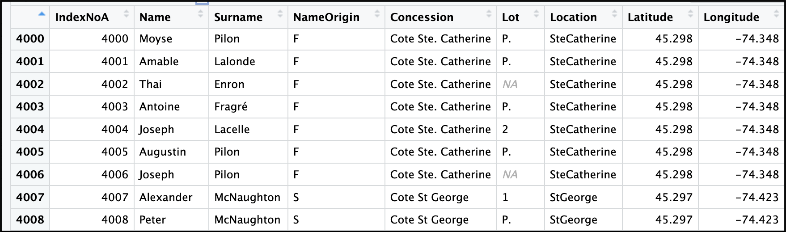

## Introduction

These *Supplementary Materials* concentrate on decisions made during the data transcription process that affect the present form of the curated data. To some extent they also describe the context in which the data were originally collected in 1852.

## **Part A: *NameOrigin* Variable Creation**

The European settlement of Vaudreuil County was predominantly by French speaking families, and Glengarry County predominantly by Gaelic speaking Scots. There were also English and Irish settlers in both counties, some French speakers in Glengarry, and Scots, English and Irish in Vaudreuil, as well as some people born in the United States, and even fewer from Germany or elsewhere. 

Is it possible to make these cultural, ethnic or language differences explicit at the household level? One way to do this would be to look at the Personal Census for each household. In the column for "Place of Birth" (fr. *Lieu de naissance*) what we might term "ethnicity" was also indicated after the place of birth was recorded, almost always by abbreviations in the original manuscripts. Hence, Scottish = S or Scottish Canadian = SC in the English language schedules, and the equivalent in French language schedules (so, *Écossais* = E, and CE = *Canadien écossais*). The enumerators were consistent in these assignments and this would be the best option, since the assignments are those of the enumerators at the time. However, it is a tedious way of making an "ethnicity" variable. If the Personal Census data are integrated with the Agricultural Census, a new ethnicity variable should be made in this manner.

Instead, for the curated data set the ethnicity assignment used was based on the likely ethnicity associated with the *Surname* of the proprietor, with a check with the Personal Census in potentially ambiguous cases. The name of the variable, *NameOrigin*, is meant to convey the method used to create this "Ethnicity" assignment.

The assignment was done at the SubDistrict level. For each SubDistrict, a list of unique surnames was created, and then an "Ethnic" identification of "English" (E), "French" (F), "Irish" (I), "Other"(O), and "Scottish" (S), was assigned to each unique name using the (English) first initials of each ethnicity.

What follows shows how this was done, using the example of the subdistrict of Newton Township in Vaudreuil---chosen because it is small, and because its diversity of ethnicities.

Starting with the data for a SubDistrict, a data frame was made showing the unique *Surnames* for that SubDistrict, and a csv file was made for this tally. Using the csv file in spreadsheet software, each distinct surname for that SubDistrict was assigned an "Origin". This was done "manually", the transcriber assigning one of the five initials to each name. For the most part, this assignment was straightforward: Barbeau, Bellehumeur, Monpetit are clearly French names, McCosham, McCuaig, Morrisson are Scottish and so on. @tbl-newton-tally below shows a portion of the *Surname* tally for Newton, where there were 43 unique surnames.

However, there can be ambiguity. The names Hamilton and Hope could be English or Scottish, for example. There are Scots and Irish McDonalds, and in Vaudreuil, there are surnames seemingly English, where, judging by the names of children and religious affiliation, the family appears to be culturally French Canadian, and is so assessed by the enumerator in the Place of Birth column. Inter-ethnic marriages occurred especially among the English, Irish and Scottish families, so that some of the ambiguity reflects common North American ethnic mingling.

The procedure followed can be read from the code and code comments below, using the SubDistrict of Newton as an example.

```{r}
#| echo: true
#| eval: false
library(mosaic)
library(tidyverse)
#Work with a SubDistrict filtered file, here NewtonWork for SubDistrict Newton
#Get a tally of unique surnames
SurnameTallyNewton <- as_tibble(tally(~Surname, data = NewtonWork))
#make a csv file of the tally to work with
write_csv(SurnameTallyNewton, file = "SurnameTallyNewton.csv")
#Make the assignments of Origin by hand on the spreadsheet, 
#Import the resulting Origin assignments file as SurnameTallyNewtonAssigned
#Make the Lists of each 
TallyNomNewtonSplit <- SurnameTallyNewtonAssigned |>
  split(f = SurnameTallyNewtonAssigned$Origin)
#Create the variable NameOrigin in the Newton data
NewtonWork1 <- NewtonWork |>
  mutate(NameOrigin = case_when(Surname %in% TallyNomNewtonSplit$E$Surname ~ 'E',
                                Surname %in% TallyNomNewtonSplit$F$Surname ~ 'F',
                                Surname %in% TallyNomNewtonSplit$I$Surname ~ 'I',
                                Surname %in% TallyNomNewtonSplit$S$Surname ~ 'S',
                                TRUE ~ 'O')) |>
  relocate(NameOrigin, .after = Surname)
```

The possible code shown just above needed to be tweaked for the SubDistrict of St. Clet, where the enumerator over-struck the names of proprietors who were not farmers, so that the *Surname* was often (but not always) unclear, and was recorded as "\[unclear\]". An additional line to mutate had to be added to make these instances into "NA".

The assignments were made at the SubDistrict level, facilitating the checking of "ambiguous" names especially against the Personal Census. The SubDistrict files were ultimately assembled into the complete data set.

For the entire data set, the tally of the assignments can be seen in @tbl-nameorigin-tally. For analysis purposes, NameOrigin can be collapsed into Francophone and Non-Francophone origin.

\newpage

|     | Surname     | n   | Origin |
|-----|-------------|-----|--------|
| 1   | Barbeau     | 2   | F      |
| 2   | Beaid       | 1   | F      |
| 3   | Bellehumeur | 1   | F      |
| 4   | Burke       | 1   | I      |
| 5   | Campbell    | 2   | S      |
| 6   | Charleboois | 1   | F      |
|     | . . .       | .   | .      |
| 37  | Morrisson   | 8   | S      |
| 38  | Ryly        | 1   | I      |
| 39  | Séguin      | 1   | F      |
| 40  | St. Armand  | 3   | F      |
| 41  | St. Arnaut  | 1   | F      |
| 42  | Stackhouse  | 1   | E      |
| 43  | Timmins     | 1   | F      |

: Example of Surname Tally and Assignment: SubDistrict of Newton {#tbl-newton-tally}

| County    | English (E) | French (F) | Irish (I) | Other (O) | Scottish (S) |  NA | Total |
|---------|--------:|--------:|--------:|--------:|--------:|--------:|--------:|
| Glengarry |          70 |        134 |       215 |         5 |         1913 |   0 |  2337 |
| Vaudueuil |          92 |       1937 |        89 |         2 |          159 |  16 |  2295 |
| Total     |         162 |       2071 |       304 |         7 |         2072 |  16 |  4632 |

: *NameOrigin* tally by County {#tbl-nameorigin-tally}

## **Part B: Concession, Lot, Location, Latitude, Longitude**

Ideally, we would like to have the latitude and longitude of each farm, as geomorphological features vary spatially. In addition, the location of farms affords the opportunity to assess the influence of neighbors on the choice of enterprises embarked upon.

For Glengarry but not for Vaudreuil, getting the latitude and longitude of each farm is possible, and what follows describes the determination of latitude and longitude for each farm. For Vaudreuil, specification of latitude and longitude is not possible for each farm but for some areas it is possible to locate a holding more exactly than the latitude and longitude of the SubDistrict.

### Glengarry County

The determination of latitude and longitude for each farm (or holding) in Glengarry is based on the way farm plots have been numbered and mapped in Ontario. In Glengarry County, there are four townships (or SubDistricts for the census) and for each of these, there are nine "concessions", which can be thought of as ribbons of land running parallel with the St. Lawrence River, and numbered Concession 1 through 9 from south to north. (It can be added that the word "concession" does not imply a grant to a person or community; it is simply a naming convention.).

These concessions were divided and numbered from east to west into about 37 or 38 rectangular lots with the short side 0.25 mile and the long side 1.25 mile, where the long side formed the north-south "depth" of a concession, resulting in a land grant of 200 acres for most lots. Hence, each concession can be thought of as a rectangle with the width being the east-west extent of the township, and height (or depth) 1.25 miles. @fig-concessions (a), below, shows a part of this pattern for the 9th concession of Kenyon, near the village of Dunvegan.

There are exceptions to the general pattern, especially in Charlottenburgh SubDistrict, where some concessions paralleled the River aux Raisins, and in Lochiel, where there is a triangular area on the eastern side known as the "Gore". In addition, on the western side of Charlottenburgh and Kenyon, the St. Regis Indian Reserve Lands were given their own numbered south to north concession structure. But these "Indian Lands" concessions were treated as part of each of the two townships (or SubDistricts) in the census. The entries for the column Concession in the census manuscripts have been transcribed to the variable Concession in the data set.

This Concession and Lot structure is still in use today, and using the Ontario Ministry of Natural Resources *Make a Topographical Map* website ([*here*](https://www.lioapplications.lrc.gov.on.ca/MakeATopographicMap/index.html?viewer=Make_A_Topographic_Map.MATM)) it is possible to search for and make a map that specifies the location of a farm according to its Township, Concession and Lot Number. With the map of the farm, there is a link to its latitude and longitude. (See @fig-concessions, below.)

For Glengarry, for each proprietor (row in the data) the enumerators recorded the concession number in the column “Concession” and the Lot number in the column “Lot”. As might be guessed, a great many of the original 200 acre plots had been divided by 1851, and also some proprietors farmed lots made up of more than one concession and lot designation, often adjoining. The enumerators quite often noted these divisions, though not consistently through the county; thus, in the Lot column, an enumerator might enter E ½ 27, indicating that the farm was the eastern half of lot 27. Whatever the enumerator entered in this column has been recorded in the variable *Lot*. The entries for the column Concession in the census manuscripts have been transcribed to the variable *Concession* in the data set.

::: {#fig-concessions}


(a) *Left:* Concessions and Lots for a part of Kenyon showing 200 acre lots. (Source: Ontario Ministry of Natural Resources); (b) *Right:* Concessions and Lots for a part of St.-Polycarpe. (Source: Carte cadastrale de Soulanges (1921), from CAVS).
:::

To specify the Latitude and Longitude for each farm, the township, concession number and lot number were used in the website: *Make a Topographical Map* ([*here*](https://www.lioapplications.lrc.gov.on.ca/MakeATopographicMap/index.html?viewer=Make_A_Topographic_Map.MATM).) In that website one can use Search ---\> Search by Location ---\> Select a Township: type in the name of the township and then specify the Lot and Concession. There are menus giving what concessions are in each township, and what lot numbers are in each concession. Doing this will create a map highlighting the specific land searched for. From the map produced, right-clicking on any point will give the latitude and longitude as well as a modern road address, and other information. For the latitude and longitude recorded in the columns *Latitude* and *Longitude*, the center of the farm (i.e., defined by *Concession* and *Lot*) was visually estimated from the map produced. Where the enumerator specified a part of the lot (such as in the example above: E ½ 27), the center of the part of the lot specified was used. Where the enumerator did not further indicate a division, the center of the entire lot was used. In these instances, two farms with the same Concession and Lot may thus share the same latitude and longitude even though it is certain that one of the farms is (say) the eastern half, and the other the western half, or some other partition.

There are also villages and hamlets made up of small holdings that share the same Township, Concession and Lot designations, and hence have the same *Latitude* and *Longitude* assignment (e.g., the village of Dalhousie Mills is located at Lancaster, Concession 8, Lots 8 or 9). This also results in many rows in the data sharing the same latitude and longitude. For visualization, and even for some analyses, it is thus convenient to introduce some very small random "jitter" to *Latitude* and *Longitude*.

In some instances, a proprietor may have more than one lot for the holding, most often contiguous farms (e.g., Lots 17 and 18 within Concession 6, or E ½ 18 and W ½ 17); in these cases the approximate center of the holding was used for the latitude and longitude. In some very few instances, the holdings for a proprietor were non-contiguous; in these few cases, a judgment had to be made as to what was likely to constitute the main part of the farm operation.

There is a variable named *Location* in the data set. For Glengarry County, where we are able to specify *Latitude* and *Latitude* for each farm fairly exactly, the word "farm" has been entered for the variable *Location*.

### Vaudreuil County

For Vaudreuil County, it has not been possible to specify latitude and longitude for each farm as in Glengarry County. The reason can be traced to the way the columns Concession and Lot in the original manuscripts were used in Vaudreuil. In Vaudreuil, where (with the exception of Newton Township) the seigneurial land tenure system prevailed, there were designated concessions and these generally had names (e.g. *Concession St.-André Ouest*). Also, lots were numbered within these concessions, as can be seen with contemporary maps from the nineteenth century (See @fig-concessions (b)). However, these lot numbers were not recorded in the column Lot. Instead, that column was used to designate whether the farm consisted of one lot, two lots, ½ lot, or (very often) a part of a lot (“P”) without specifying the fraction. These designations have been transcribed to the variable *Lot.* The important point here is that the variable *Lot* has different information depending upon the County and SubDistrict. In Glengarry and in Newton in Vaudreuil, the variable *Lot* gives the number of the lot according to the numbering system used. In Vaudreuil (except for Newton) the variable *Lot* shows the number of lots comprising the holding, including often fractions, or the letter “P”.

For Vaudreuil, the concession names were usually indicated in the census column named *Rang ou concession*, although sometimes the enumerators used abbreviations for the names. Very often, the concession was named at the first instance of that concession, and then with “ditto” marks for all those rows below for holdings that were in the same concession. At times, however, the column was left blank. Whatever was recorded about the concession name in the column *Rang ou concession* was entered to the variable *Concession* in the transcribed data.

Hence, except in a very few cases where old maps indicate the family name of the proprietor, it is not possible from the census manuscripts to spatially locate individual farms, and thus, not possible to specify latitude and longitude for these holdings at the farm level. However, it is possible to specify the concessions and in many (but not all instances) locate these concessions using old maps.

To further specify the location of the farm, concession-based “SubSubDistricts” or *Locations* were created based on the named concessions on cadastral maps kindly provided by the Centre d’archives de Vaudreuil-Soulanges (CAVS). The latitude and longitude of these smaller concession based *Locations* were determined using modern mapping software, such as Google maps. These *Locations* have been named and comprise the entries for the variable *Location* in the data.

For some areas, where good maps exist, and the enumerators were very specific about the concession names (such as for the subdistricts of St. Polycarpe and Ste. Marthe) the creation of the Locations has been fairly successful in more exactly specifying the location of a farm. But for other areas in Vaudreuil, the specification was more problematical; as noted above, in some cases, the enumerators used only abbreviations, and in some cases left the column blank. With the help of the archivists of the CAVS, some of the abbreviations have been identified — but not all. What follows explains in some detail how the Locations and the associated Latitude and Longitude were created.

@tbl-location-definition shows the assignment of *Location* for the subdistricts of Vaudreuil, including *Latitude* and *Longitude*, as well as the location of the latitude and longitude expressed as a modern “road address”. For each of the assignments, more information on the assignment is included in the notes, which are shown in @tbl-notes.

The next paragraphs summarize some of the decisions made that are listed in @tbl-notes. For example, Note 1 in @tbl-notes refers to the SubDistrict L’Île-Perrot. For this subdistrict, the abbreviations used were not able to be identified, and hence, the Latitude and Longitude for *Location* Perrot is thus the center of the entire subdistrict.

At times, the enumerators left the column *Concession* blank for some rows, even where the concessions were identified for most rows. In these cases, the blank (or NA) rows were assigned the center of the SubDistrict as a whole, and the successfully assigned concessions the centers of the concessions determined by maps. (Notes 4 and 5 of @tbl-notes are examples.)

For the column *Rang ou concession* the enumerator for Rigaud entered “R” or “C” or left the column blank. It is possible that the meaning of these designations can be ascertained by comparing proprietor's names in later censuses, or for maps that not available to the transcriber. For Rigaud, the assignment for *Location* is thus the center of the entire SubDistrict, given present information.

For the subdistrict of Newton Township, concessions and lots were numbered, following the general pattern for Glengarry County, although the concessions were numbered from north to south, and the lot numbers from west to east, as well there being an addition of an “augmentation” lot just next to the Ontario border that was added when the Ontario/Quebec boundary was corrected. Newton Township was quite sparsely populated in 1851, with a concentration of population in the three most northerly *rangs.* The *Location* assignments are specified in Note 2 of @tbl-notes.

::: {#tbl-location-definition}
{fig-align="center"}

Location Definition for SubDistricts in Vaudreuil: Name, Latitude, Longitude, Modern Location, with Notes. For Notes in column 6, see @tbl-notes.
:::

::: {#tbl-notes}


Notes to @tbl-location-definition on Location Definitions for Vaudreuil
:::

## **Part C: English and French Units of Measurement**

Because Quebec was originally part of New France until ceded to Great Britain in 1763, some units of measurement for the 1851 Census are French in origin. These units were in common usage long after the area was ceded, and were used in the 1851 Agricultural Census. The list of units used can be found in the “Column Headings” in the Library and Archives Canada (LAC) Census website [*here*](https://library-archives.canada.ca/eng/collection/research-help/genealogy-family-history/censuses/pages/column-headings.aspx#a1_5). What follows is an explanation of the differences, and how they were translated to a common set of units for the curated data set.

For the curated data set, most French units were translated into the English units being used in 1851. Given that Canada now uses metric units for distance and weight, another excellent choice might be to translate both the English and French to metric units, in which case measures of land area should be hectares or square meters rather than acres. However, even though the official measurement units in Canada today are metric, one finds that for land, traditional English units (acres and square feet) are often still used as well. For example, the areas of residential properties for sale are often expressed in square feet, even in Quebec (fr. *pieds carrés*), and for land area for rural properties, acres are often used, though hectares are becoming more common. Moreover, it is likely that for United States students, the traditional English units will be more familiar, though one might want to mount a covert effort to promote using metric units. If metric units are preferred it would be a simple exercise to translate the English units used in the curated data set.

The conversions were mostly but not entirely on the Vaudreuil part of the data; hence the Glengarry and Vaudreuil parts were treated separately, and then joined together after the conversions had been made. As will be seen below, for the production of hay, a new variable was created so that both the English and French measures of the production could be shown.

### Land Area: *Arpent* and Acre

In the areas under *seigneurial* land tenure, which means all of Vaudreuil except Newton, land area in the census was expressed in *arpents.* An *arpent* can be used to measure linear distance or to measure area, but in the census, only the areal measure is used. For the curated data set all of the land areas have been converted to acres using the conversion factor: 1 *arpent =* 0.8448 acre, here expressed to four decimal places. The actual conversion used ten decimal places, and then rounded.

To make the conversion, the Vaudreuil data were first filtered to exclude Newton. Then a list of all of the variables in which land measures were used was made, called “landnames”. The effective part of the conversion can be seen in this snippet of R code:

```{r}
#| echo: true
#| eval: false
library(mosaic)
library(tidyverse)
VaudreuilCountySansNewtonWork7ae2 <-VaudreuilCountySansNewtonWork7ae |>
  mutate(across(all_of(landnames), ~ round(.x * 0.8448268401, 3)))
```

The converted measures are rounded to three decimal places. The assembling of the Glengarry and Vaudreuil was left until all the conversions had been done.

### Volume Production Measures: *Minot* and Bushel

In the seigneurial areas of Vaudreuil, the volume production measurement unit for many crops was the *minot*, whereas for Glengarry and for Newton in Vaudreuil, the measurement unit was the *bushel*. The Library and Archives Canada (LAC) list of column headings referred to in the link above may give the impression that a *minot* is equal to a bushel. It is close, but not the same. The conversion factor used for the curated data is: 1 *minot* = 1.107 bushel. The procedure for conversion followed that for land area; a list of the variables in which production measures in *minots* was made (called “Prodnames”) so that the effective part of the conversion can be seen here.

```{r}
#| echo: true
#| eval: false
library(mosaic)
library(tidyverse)
VaudreuilCountySansNewtonWork7ae2 |>
  mutate(across(all_of(Prodnames), ~ round(.x * 1.107, 3)))
```

A further note: The LAC list of column headings for Canada East (i.e., Quebec) for the production of oats gives: “*Avoine: produit en boisseaux (Oats: bushels)”*, and not *minots.* However, the manuscript column heading in the actual schedules has *minots.*

### Production Measures Using Pounds

Some production measures (butter, cheese, maple sugar) were measured in pounds in both counties. No conversions were necessary for these.

### Production Measures for Cloth: *Verge* and Yard

For cloth production — flannel, fulled cloth as well as for canvas — The French *verge* was taken to be equivalent to the English *yard.* The English linear measure *yard* is officially 0.9144 m. Some sources put the French *verge* at 0.92 m. The two measures were taken to be equivalent in the census transcription.

### Production Measures for Hay: *Botte* and Ton

For Glengarry and for Newton Township in Vaudreuil, production of hay was measured in tons. For the remainder of Vaudreuil, the measure was the *botte.* In the LAC list of Column Headings for Canada East referred to above, the translation of *botte* is given as “bale”. This is a bit misleading for a modern reader, who is likely to think of bales of 60-70 lbs. or more. A better translation is given in the Census Report ([@Canada1855], available [*here*](https://publications.gc.ca/collections/collection_2012/statcan/rh-hc/CS98-1851-2-eng.pdf)), where *botte* is translated “bundle”, and is calculated to be about 14-16 lbs. Interestingly, the summary tables in the Census Report give totals in both measures for both Ontario and Quebec, and this provides us with a numerical translation; it appears from that calculation that: 1 ton = 140 *bottes.*

However, it is a little unclear whether a short ton (2000 lbs) or a long ton (2240 lbs) is being used; if a short ton, then a bundle (or *botte)* is approximately 14.3 lbs. The long ton calculation makes a bundle equal to 16 lbs. @fig-weight-measures, below, from [@Ross1983], p 94) does not settle the issue, partly because it is not certain which measure was being used prior to about 1860.

For the production of hay, we made two variables, to follow the Census Report ([@Canada1855]),: one in which the production is described in *bottes*, and the other in which the production is in tons. The first variable, in *bottes,* is named *Foin* and the second, in tons, is named *Hay,* using the equation of 140 *bottes/*ton shown in the previous paragraph. The conversions from tons to *bottes* were rounded to zero decimal places, and the conversions from *bottes* to tons to one decimal place.

### Pork and Beef Production: *Quint*, Hundredweight, *Baril,* Barrel, Pound

For pork and beef production, the measures did not differ so much along the language or land tenure dimensions as the choice that the enumerator made. Most of the enumerators chose to record the quantities in hundredweight (or *quints*) but some opted for pounds, and some for barrels or *barils*. Hundredweight (Cwt.) and Quints are equivalent to 100 pounds, while Barrels and Barils are two hundred pounds. All of the measures were translated into Cwt. (= Quints). The R code snippet will show which subdistricts needed translation. The unchanged districts, which were the majority, used hundredweight or quints. Notice that for Beef production in the SubDistrict of St. Michel, there were two enumerators, and the two made different decisions — one opting for barils and the other for pounds. (A file was made of the original numbers.) Here is the code for Pork:

```{r}
#| echo: true
#| eval: false
library(mosaic)
library(tidyverse)
GlengarryVaudreuilCountiesWork9ae <- 
  GlengarryVaudreuilCountiesWork9aePorkBeefOrig |>
  mutate(Pork = case_when(SubDistrict == "L’Île de Perrot" ~ Pork/100,
                          SubDistrict == "Rigaud" ~ Pork/100,
                          SubDistrict == "St. Ignace" ~ Pork/100,
                          SubDistrict == "St. Michel" ~ Pork/100,
                          SubDistrict == "Ste. Marthe" ~ Pork/100,
                          TRUE ~ Pork))
```

Here is the code for beef.

```{r}
#| echo: true
#| eval: false
library(mosaic)
library(tidyverse)
GlengarryVaudreuilCountiesWork9ae <- 
  GlengarryVaudreuilCountiesWork9aePorkBeefOrig |>
  mutate(Beef = case_when(SubDistrict == "L’Île de Perrot" ~ Beef/100,
                          SubDistrict == "Rigaud" ~ Beef/100,
                          SubDistrict == "St. Ignace" ~ Beef/100,
                          SubDistrict == "St. Joseph" ~ Beef*2,
                          SubDistrict == "St. Michel" & PageNo < 150 ~ Beef*2,
                          SubDistrict == "St. Michel" & PageNo > 150 ~ Beef/100,
                          TRUE ~ Beef))
```

@fig-weight-measures shows conversion factors from bushels to weight measures used in the nineteenth century for various commodities. The source is Ross (1983), available [*here*](http://parkscanadahistory.com/series/ha/68.pdf).

::: {#fig-weight-measures}


Weight Measures in Use in Nineteenth Century Ontario (Ross 1983)
:::

## Part D: Retrieving the Original Data

The columns in the data set listed below are potentially useful for finding and retrieving the manuscript for a specific row in the data are:\

\vspace{-2pt}

IndexNoA\
\vspace{-2pt} IndexNoCD\
\vspace{-2pt} Name\
\vspace{-2pt} Surname\
\vspace{-2pt} County\
\vspace{-2pt} SubDistrict\
\vspace{-2pt} PageNo\
\vspace{-2pt} LineNo\
\vspace{-2pt} IndexNoB\

To locate the original manuscript data for a specific row in the dataset, we shall consider an example. Let us suppose that we wish to investigate the manuscript for IndexNoA = 4004, Joseph Lacelle, of concession Cote Ste. Catherine of SubDistrict St. Polycarpe and County Vaudreuil. To locate this line in the manuscript, one may scroll right to the variables PageNo and LineNo. For IndexNoA = 4004, these are 181 and 15; i.e., in the original manuscript, this proprietor is on page 181 and line 15. Or, alternately, one may interpret IndexNoCD = 181.15

::: {#fig-3-polycarpe}


Data for part of St. Polycarpe SubDistrict
:::

The manuscript can be found by using the *Census Search* from Library and Archives Canada ([*here*](https://recherche-collection-search.bac-lac.gc.ca/eng/Census/index)). The Census Search appears to be designed for people doing genealogical research, and consists of three questions: *When?* (choice of Census), *Who?* (the person or persons being searched for), and *Where?* (Geographical location within Canada.) At the foot of the *Where?* section, under *Place* there is an additional option: *More,* which allows one to enter the District (here, Vaudreuil) and SubDistrict (here, St. Polycarpe).

Entering the last name Lacelle, and the other information as above will yield zero results! We shall see why this happened. When one finds zero results, one workaround is to enter a nearby name in the data, such as Augustin Pilon, with all of the other entries the same. When one enters Pilon, one gets 29 results, and the second one is Augustin Pilon. Of those 29, most have an age specified; selecting an age specified result takes one to the Personal Census, whereas those without an age (such as for Augustin Pilon) takes one to the Agricultural Census. Clicking on the name takes one to the manuscript, with a thumbnail on the left showing the page number selected, which its indicated by the thumbnail being outlined. The page number being shown is given at the foot of the thumbnail, and typically, scrolling down in the thumbnail is necessary. One can print the page.

::: {#fig-lacelle}
{fig-align="center"}

Part of Page 181, Original Manuscript, St. Polycarpe SubDistrict, Vaudreuil County.
:::

We can now see why we got zero results for Lacelle: the transcriber for LAC read Locelle, and not Lacelle. One can also search using “\*” in place of a letter as a “wild card”. But it is usually quicker to use a name that is nearby.

However, there is another complication. The LAC on-line images appear to give just the odd-numbered pages of the census, and not the even numbered pages, probably because the odd numbered pages have the names of people in the Personal Census, and the search is geared toward genealogical research. So, the page before the one for Pilon is 179, and the page following is 183. 

For the Agricultural Census, however, there is a way of seeing the even numbered pages. The entire agricultural census is fully listed below the odd number pages. One needs to scroll down on the thumbnail until one reaches something like (to use our example) “Page 83h, 1a (167)”. The images starting with “1a” and following, will give the complete Agricultural Census, with both even and odd pages.

It is also possible to use *FamilySearch* in much the same fashion.

## **Part E: District and SubDistrict Names and Numbers**

The Districts and SubDistricts were given numbers for reference, and these are recorded in the dataset under DistrictNo and SubDistrictNoB. (The variable SubDistrictA is the transcriber’s numbering of SubDistricts; the Census authorities’ numbering is more useful.) The Table below gives the numbers, the names of the Districts and SubDistricts used by the Census authorities. The number of households within each is also given.  So, Kenyon SubDistrict is number 82 in Glengarry, District 10.

**District Number 10: Glengarry**

| SubDistrictNoB | Name            | Number of Households |
|----------------|-----------------|----------------------|
| 80             | Charlottenburgh | 742                  |
| 82             | Kenyon          | 556                  |
| 79             | Lancaster       | 500                  |
| 81             | Lochiel         | 539                  |

**District Number 34: Vaudreuil**

| SubDistrictNoB | Name            | Number of Households |
|----------------|-----------------|----------------------|
| 533            | L;Île de Perrot | 100                  |
| 543            | Newton          | 64                   |
| 536            | Rigaud          | 279                  |
| 541            | St. Clet        | 178                  |
| 539            | St. Ignace      | 319                  |
| 540            | St. Joseph      | 213                  |
| 534            | St. Michel      | 363                  |
| 539            | St. Polycarpe   | 596                  |
| 536            | Ste. Marthe     | 183                  |

The census manuscripts for St. Zotique, SubDistrictNo = 535 in Vaudreuil no longer exist.

\newpage

## References
